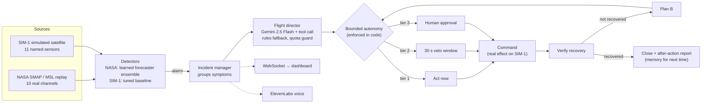

# Mission Control AI

**An AI flight controller for spacecraft.** It finds the root cause of anomalies, acts within
safe limits, checks the fix worked, and asks a human before anything risky.

UB Hacking 2026 · Radial Atoms track

| | |
|---|---|
| **Live dashboard** | **https://ubhacking-frontend-nine.vercel.app** |
| Backend API (health) | https://mission-control-ai-v3b6.onrender.com/api/health |
| API docs (Swagger) | https://mission-control-ai-v3b6.onrender.com/docs |

> The backend runs on Render's free tier, which sleeps after 15 minutes without visitors. If the
> dashboard header says **reconnecting**, open the health link above, wait about 50 seconds, and
> refresh.

---

## Contents
1. [What it does](#what-it-does)
2. [Why two data sources](#why-two-data-sources)
3. [Try the live demo](#try-the-live-demo)
4. [Architecture](#architecture)
5. [How it works](#how-it-works)
6. [SIM-1, the simulated satellite](#sim-1-the-simulated-satellite)
7. [Results](#results)
8. [Deployment (Render and Vercel, and our Vultr plan)](#deployment)
9. [Run it locally](#run-it-locally)
10. [Configuration](#configuration)
11. [API reference](#api-reference)
12. [Project structure](#project-structure)
13. [Testing](#testing)
14. [Tech stack](#tech-stack)
15. [Known limitations](#known-limitations)
16. [Disclosures](#disclosures)

---

## What it does

Spacecraft operators watch thousands of telemetry channels. Most monitoring tools only say
*something* is wrong. A person still has to work out **why**, decide what to do, and check that it
worked. Mission Control AI runs that whole loop:

1. **Detect.** Every reading on every channel is checked by a detector calibrated on that
   channel's normal behavior: a learned forecaster plus spike, drift and frozen-sensor checks.
2. **Group.** The symptoms of one fault become one incident. A worn reaction wheel alarms on
   4 sensors but is handled as 1 problem.
3. **Diagnose.** A **Gemini flight director** reads a case file (symptoms and their timing, all
   sensors against their normal ranges, orbit, ops plan, past incidents) and can call a tool for
   sensor history. It must name the **root-cause part**, the **evidence**, an **action**, and a
   **plan B**. If Gemini is unavailable, rules take over automatically.
4. **Act with bounded autonomy.** Code, not the AI, enforces the limits:
   - low-risk actions run at once
   - medium-risk actions get a 30-second veto countdown
   - safe mode needs a human to approve
5. **Verify.** If nothing recovers, it runs **plan B**. If that fails too, it escalates to an engineer.
6. **Report.** Every step is spoken with **ElevenLabs** voice and shown live on a 3D dashboard.
   Each incident ends with an after-action report that becomes memory for the next one.

## Why two data sources

| | **NASA replay** (real) | **SIM-1** (simulated) |
|---|---|---|
| Data | Real SMAP (Earth satellite) and Curiosity (Mars rover) telemetry, from NASA's public anomaly dataset | A fictional satellite we built, labeled "Simulated" everywhere |
| Channel names | Anonymized codes (`P-1`, `A-1`, ...). Only P = Power and R = Radiation are documented | 11 named sensors in real units (battery voltage, wheel speed, ...) |
| Commands | Can't change a recording, so they are simulated | **Really change the satellite** |
| Ground truth | Where anomalies are (expert labels) | **Why** they happen (a hidden answer key per scenario) |
| What it proves | **Detection** works on real spacecraft data (precision / recall) | **Decisions** are right (root-cause accuracy) |

Real data alone can't show an AI *reasoning about causes*, because nobody knows what `A-1`
measures. A simulator alone isn't credible. Together they cover both.

## Try the live demo

Open **https://ubhacking-frontend-nine.vercel.app** and wait for **● live** in the header.

**Simulated satellite (the agent at work)**
1. Click **SIM-1** in the header switch.
2. Optional: click **Enable voice** to hear the flight director.
3. Under **Run a fault scenario**, click one:
   - **Reaction wheel friction**: four symptoms, one incident, then a switch to the backup wheel.
   - **Imaging pass in eclipse**: looks like a dying battery but is planned. The right answer is to do nothing.
   - **Solar array power loss**: the battery drains in sunlight because the array failed.
   - **Frozen temperature sensor**: the first fix (a reboot) fails, so plan B runs.
4. Watch the incident card fill in:
   - symptoms and their timing
   - **root cause** and **evidence**
   - **plan B**
   - the countdown, with **Cancel**
   - commands sent and their results
   - the **answer key** once it closes
5. The **scoreboard** grades the flight director against the hidden answer key.
6. **Reset satellite** returns everything to healthy.

**Real NASA data**
1. Click **NASA**, then click a channel card or a node in the 3D view.
2. **Inject synthetic fault**: Spike, Drift or Flatline.
3. Or **Replay NASA anomaly** to jump to just before a real labeled anomaly.

Use **1× / 5× / 20×** to change playback speed. For the simulator, 1–2× is best, because the
veto countdown runs in real time while the orbit keeps moving.

## Architecture



| Layer | Where it runs | Code |
|---|---|---|
| Dashboard (static HTML, three.js) | **Vercel** | `frontend/` |
| API, WebSocket, engine, agent | **Render** (Docker) | `app/` |
| Diagnosis | Google Gemini API | `app/agent.py` |
| Voice | ElevenLabs API | `app/voice.py` |
| Storage | In memory; optional PostgreSQL / Tiger Data via `DATABASE_URL` | `app/storage.py` |

## How it works

### 1. Streaming
`app/replay.py` runs an always-on engine. Every 0.1 s it:
- reads the next values from each NASA channel's test file (looping at the end)
- advances the SIM-1 physics one step per reading
- runs the detector on every reading
- streams the batch to the dashboard over the WebSocket

At 1×, each channel produces 10 readings per second. NASA's files have no timestamps, so this
playback rate is our choice.

### 2. Detection
**NASA channels use an ensemble.** An alarm fires if either detector fires (`app/forecast.py`):
- **Learned forecaster.** For each channel, a ridge-regression model predicts the next reading
  from the last 30 readings. It alarms when reality keeps disagreeing with the forecast (smoothed
  error, z-scored on held-out training data). A run only becomes an alarm once its peak surprise
  reaches 8. This is NASA Telemanom's method with a lighter model.
- **Baseline checks** (`app/detector.py`):
  - **jump** (spike)
  - **envelope** (drift outside the trained range)
  - **stuck** (frozen reading, checked only where training data is rarely still)

Both need 12 bad readings in a row. The incident's shape (spike / drift / flatline) comes from
how the run **started**.

**SIM-1 uses the baseline checks** on values scaled to −1..1, NASA's preprocessing, with a
persistence of 6. That gave **0 false alarms in 18 healthy test orbits**.

### 3. Incidents
`app/incidents.py` moves each incident through these stages:

`detected → analyzing → diagnosed → veto window / awaiting approval → monitoring → closed`, or **escalated**

On SIM-1, one fault gives one incident: every sensor that alarms while it's open is linked as a
symptom, with timing.

### 4. Flight director (Gemini)
`app/agent.py`, using `gemini-2.5-flash` through the `google-genai` SDK:
- **Request 1:** Gemini sees the case file and may call a tool:
  - `get_sensor_history` on SIM-1
  - `get_related_channels` on NASA
- **Request 2:** a strict JSON-schema answer. On SIM-1 that's the root-cause part, the action and
  its target part, evidence, a plan B, confidence, and a voice line. Answers outside the allowed
  parts and actions are rejected.
- **SIM-1 handbook prompt:** explains how the parts work and connect, never the fault signatures
  or the answers.
- **Fallback:** if Gemini fails, times out, returns an invalid answer, or is over quota, the
  rule-based diagnosis takes over and the demo keeps going.
- **Quota guard:**
  - Each incident costs 2 requests.
  - Only demo-triggered incidents (`GEMINI_SOURCES`) use Gemini.
  - A daily cap (`GEMINI_DAILY_LIMIT`, default 18 of the free tier's 20) persists across restarts.
  - Plan B costs no extra request.

### 5. Bounded autonomy

| Tier | Actions | What happens |
|---|---|---|
| 1 | `monitor`, `call_engineer` | Runs at once |
| 2 | `power_cycle_sensor`, `switch_to_backup`, `shed_load` | Runs after a 30 s veto window (operator can **Cancel**) |
| 3 | `safe_mode` | Waits for the operator to **Approve** (reminders, never acts alone) |
| 4 | Change limits, alarms, its own permissions | **Never**: not in the action menu |

Low confidence moves a tier 2 action up to tier 3. There's a command cooldown per unit, and the
action menu is fixed in code.

### 6. Verify, plan B, report
- After acting, the agent watches every symptom for up to 45 mission minutes.
- If nothing recovers, or the command can't help (for example "no backup battery"), it runs the
  plan B from the original diagnosis, under the same tiers.
- Every SIM-1 incident ends with an **after-action report**: what happened, the evidence, each
  command and its result, and the outcome. The last 5 reports are given to the flight director as
  memory, without answer keys.

### 7. Voice
`app/voice.py` sends each step to ElevenLabs (`eleven_flash_v2_5`) and caches the mp3 by its
text, so repeated phrases cost nothing. The dashboard plays lines in order and falls back to the
browser's own speech.

## SIM-1, the simulated satellite

A small, **fictional** Earth-orbiting satellite (`app/sim.py`):
- **Orbit:** 95 minutes per orbit, 35 of them in Earth's shadow, compressed to 3 minutes at 1×.
- **How parts connect:**
  - Sunlight drives solar current, which charges the battery.
  - Loads drain the battery in eclipse.
  - The heater's thermostat trusts the active battery temperature sensor.
  - A worn reaction wheel draws more current, heats up, and loses pointing.
- **Backups:** one spare (unit B) each for the reaction wheel, temperature sensor, heater controller and radio.

| Subsystem | Sensors |
|---|---|
| Power | `SOLAR_I` solar array current (A), `BATT_V` battery voltage (V), `LOAD_P` power draw (W, context only) |
| Thermal | `BATT_T` battery temperature, `PANEL_T` solar panel temperature (°C) |
| Attitude | `WHEEL_RPM`, `WHEEL_I` motor current, `WHEEL_T` wheel temperature, `POINT_ERR` pointing error |
| Comms | `RADIO_SNR` signal margin (dB), `TX_T` transmitter temperature (°C) |

**Fault scenarios.** The true cause is hidden from the AI and shown only after the incident closes:

| Scenario | What alarms first | True cause | Correct action |
|---|---|---|---|
| Radiation glitch | Transmitter temperature spike | none (single-event upset) | monitor |
| Imaging pass in eclipse | Battery voltage below normal, in shadow | none (planned operation) | monitor |
| Reaction wheel friction | Wheel current, temperature, pointing, speed | reaction wheel | switch wheel to backup |
| Solar array power loss | Battery voltage below normal, **in sunlight** | solar array | switch off payload / safe mode / call engineer |
| Heater stuck on | Battery temperature too high | heater controller | power cycle or switch heater controller |
| Frozen temperature sensor | Battery temperature frozen | temperature sensor | switch to backup sensor (a reboot doesn't help) |

## Results

### NASA detection: precision and recall on all channels
Run with `python scripts/evaluate.py`; every result file is in `results/`.
- **Data:** NASA's label file has 82 rows. P-2 is listed twice, so this is **81 unique channels**
  with **105 labeled anomalies**.
- **Scoring:** event-level, Telemanom style. A labeled anomaly counts as caught if any alarm
  overlaps it.

| Detector (all 81 channels) | Precision | Recall | F1 | False alarms |
|---|---|---|---|---|
| Baseline checks, persistence 3 (first version) | 33.2% | 67.6% | 44.5% | 143 |
| Baseline checks, persistence 12 | 72.8% | 56.2% | 63.4% | 22 |
| Learned forecaster alone | 74.7% | 59.1% | 66.0% | 21 |
| **Ensemble, the live default** | **67.6%** | **69.5%** | **68.5%** | **35** |
| Ensemble on SMAP (54 channels) | 72.5% | 72.5% | | |
| Ensemble on MSL (27 channels) | 59.0% | 63.9% | | |
| Ensemble on the 10 live demo channels | 100% | 56.2% | | 0 |
| *Reference: NASA Telemanom LSTM (Hundman et al., 2018)* | *87.5%* | *80.0%* | | |

**How the settings were chosen, honestly.** Persistence (3, 5, 8, 12, 20) and the peak gate (6,
8, 12) came from a sweep on these same labels. All runs are saved in `results/`, and each setting
moved SMAP and MSL in the same direction. NASA's command columns were tried as model inputs and
made results worse, so they are not used. Precision is still below Telemanom, mostly on MSL.

### SIM-1: does the flight director find the true cause?
Graded automatically against the hidden answer key (`GET /api/sim/scoreboard`).

| Scenario | Naive rules | Gemini flight director (real API) |
|---|---|---|
| Radiation glitch | ✅ none, monitor | *pending* |
| Imaging pass in eclipse | ❌ blamed the battery | ✅ **none, planned imaging pass: monitor** |
| Reaction wheel friction | ✅ reaction wheel | *pending* |
| Solar array power loss | ❌ blamed the battery | ✅ **solar array: payload off, then plan B (safe mode), then engineer** |
| Heater stuck on | ❌ blamed the battery | *pending* (that run hit the free-tier rate limit; rules took over) |
| Frozen temperature sensor | ✅ temperature sensor | *pending* |
| **Root cause right** | **3 / 6** | **2 / 2 so far** |

The naive rules blame the part the first alarming sensor describes. They fail exactly when the
cause sits elsewhere. Gemini's evidence quoted the data. For example, on the solar loss: *"solar
array current is 0.602 A, significantly lower than the expected 2.27 A … in 100% sunlight."* The
remaining Gemini runs are limited by the free tier's 20 requests per day.

## Deployment

| Part | Host | Address |
|---|---|---|
| Dashboard | **Vercel** (static, root directory `frontend`) | https://ubhacking-frontend-nine.vercel.app |
| Backend | **Render** (Docker, free tier) | https://mission-control-ai-v3b6.onrender.com |

**How they connect.**
- `frontend/config.js` points any `*.vercel.app` page at the Render backend, for REST, the
  WebSocket (`wss://`) and voice audio.
- Locally, uvicorn serves the dashboard itself and `config.js` leaves the address empty.

**Data in the cloud.** `demo_data/` is a 370 KB copy of the 10 demo channels (value column only,
float32), built by `python scripts/make_demo_data.py`. The full 425 MB dataset stays out of git,
so Render builds straight from GitHub.

**Secrets.** API keys are set as host environment variables, never in git.

### Why Render instead of Vultr
We planned to host the backend on **Vultr**, but the hackathon's **Vultr credit activation
failed** during the event. The organizers asked teams not to use Vultr and to describe how they
would have. We deployed on **Render** instead, using the same Dockerfile.

### How we would use Vultr with access
| Need | Vultr service | Why it's better than our current setup |
|---|---|---|
| Always-on backend | **Vultr Cloud Compute** VM running our Docker image, with Caddy for automatic HTTPS / `wss://` | No free-tier sleep or 50 s cold start. A persistent disk keeps the voice cache. |
| Full NASA dataset | **Vultr Object Storage** (S3-compatible) | Serve the full 425 MB dataset instead of a 10-channel slice, so the live demo could switch among all 81 channels |
| A real LSTM detector | **Vultr Cloud GPU** | Train one LSTM forecaster per channel, as Telemanom does, to beat our ridge forecaster's precision, then ship the weights to the VM |
| Incident memory | **Vultr Managed PostgreSQL** | The app already writes incidents and events through `DATABASE_URL`, so memory would survive restarts (our current storage is in memory) |

Moving over is a `docker build` plus `docker run` on the VM and one line in `frontend/config.js`.

### Deploy your own
1. **Backend:** create a Docker web service from this repo (Render, Fly, a VM...). Set
   `ELEVENLABS_API_KEY`, `ELEVENLABS_VOICE_ID` and optionally `GEMINI_API_KEY` in the host's
   environment settings. The image already uses `demo_data/` and `$PORT`.
2. **Dashboard:** import the repo on Vercel with root directory `frontend`, framework "Other",
   and no build command. Put your backend URL in `frontend/config.js`.

## Run it locally

Requirements: Python 3.12 or newer.

**Windows (PowerShell)**
```powershell
python -m venv .venv
.venv\Scripts\Activate.ps1
pip install -r requirements.txt
Copy-Item env.template .env       # then set DATA_DIR=demo_data in .env (or download the full data below)
uvicorn app.main:app --port 8000
```

**macOS / Linux**
```bash
python -m venv .venv && source .venv/bin/activate
pip install -r requirements.txt
cp env.template .env              # then set DATA_DIR=demo_data in .env
uvicorn app.main:app --port 8000
```

Then open http://localhost:8000 (dashboard) and http://localhost:8000/docs (API).

**Everything works without keys.** Each missing key has a fallback:

| Missing | Fallback |
|---|---|
| `GEMINI_API_KEY` | Rule-based diagnoses |
| `ELEVENLABS_*` | Captions and the browser's own speech |
| `DATABASE_URL` | In-memory storage |
| NASA data | Clearly labeled synthetic channels |

**Full NASA dataset** (needed for `scripts/evaluate.py` on all 81 channels):
- macOS / Linux: `./scripts/download_data.sh` (needs a Kaggle API key)
- Windows:
  1. `kaggle datasets download -d patrickfleith/nasa-anomaly-detection-dataset-smap-msl -p raw`
  2. `Expand-Archive raw\nasa-anomaly-detection-dataset-smap-msl.zip -DestinationPath raw\x`
  3. Move `raw\x\data\data\train` and `raw\x\data\data\test` into `data\`, and `raw\x\labeled_anomalies.csv` into `data\`.

## Configuration
All settings come from environment variables or `.env` (see `env.template`). Restart the server
after changing them.

| Variable | Default | Meaning |
|---|---|---|
| `DATA_DIR` | `data` | NASA data folder (`demo_data` for the small copy) |
| `CHANNELS` | the 10 demo channels | NASA channels to stream (empty = auto-pick `MAX_CHANNELS`) |
| `BASE_RATE` | `10` | Readings per second per channel at 1× |
| `SIM` / `MODE` | `on` / `both` | Simulated satellite on or off; what streams at start (`nasa`, `sim`, `both`) |
| `DETECTOR` | `ensemble` | NASA detector: `ensemble`, `forecast` or `baseline` |
| `CONSECUTIVE` / `MIN_PEAK` | `12` / `8` | Persistence and forecaster peak gate (NASA) |
| `Z_THRESHOLD` | `4.0` | Surprise score that counts as abnormal |
| `SIM_CONSECUTIVE` / `SIM_VERIFY_MINUTES` | `6` / `45` | SIM-1 persistence; how long to wait for recovery (mission minutes) |
| `GEMINI_API_KEY` / `GEMINI_MODEL` | empty / `gemini-2.5-flash` | Flight director (empty = rules) |
| `GEMINI_SOURCES` | `synthetic,sample-replay,sim-scenario` | Which incidents may use Gemini (`all` = every incident) |
| `GEMINI_DAILY_LIMIT` / `GEMINI_RPM` | `18` / `8` | Daily request cap (persists across restarts) and per-minute rate |
| `ELEVENLABS_API_KEY` / `ELEVENLABS_VOICE_ID` / `ELEVENLABS_MODEL` | empty / empty / `eleven_flash_v2_5` | Voice |
| `DATABASE_URL` | empty | PostgreSQL / Tiger Data (TimescaleDB hypertables when available) |
| `VETO_SECONDS` / `REMIND_SECONDS` / `VERIFY_TIMEOUT` | `30` / `180` / `60` | Autonomy timing in seconds (`VERIFY_TIMEOUT` applies to NASA incidents) |
| `COMMAND_COOLDOWN` / `INCIDENT_COOLDOWN` | `120` / `30` | Seconds between commands per unit; between incidents per channel |

## API reference

### REST
| Method | Path | What it does |
|---|---|---|
| GET | `/api/health` | Status, data mode, mode, SIM-1 status, Gemini / voice / storage stats |
| GET | `/api/channels` | All channels, with detector info and labeled anomaly ranges |
| GET | `/api/channels/{id}/history?n=300` | Recent values and surprise scores |
| POST | `/api/control/speed` | `{"speed": 5}` (0.25–100) |
| POST | `/api/control/mode` | `{"mode": "nasa" \| "sim" \| "both"}` |
| GET | `/api/sim` | SIM-1 status: orbit, eclipse, units, ops plan, timeline (no answer key) |
| GET | `/api/sim/scenarios` | The 6 fault scenarios |
| POST | `/api/sim/scenarios/{key}` | Start one (409 while a SIM-1 incident is open) |
| POST | `/api/sim/reset` | Healthy satellite again; closes open SIM-1 incidents |
| GET | `/api/sim/scoreboard` | Root-cause and action accuracy per diagnoser (rules vs Gemini) |
| POST | `/api/faults` | `{"channel": "P-1", "type": "spike" \| "drift" \| "flatline"}` (synthetic fault) |
| POST | `/api/replay?channel=P-1&which=0` | Jump to about 20 s before a real NASA labeled anomaly |
| GET | `/api/incidents?open_only=true&limit=50` | Incidents, newest first |
| POST | `/api/incidents/{id}/approve` · `/decline` · `/cancel` | Operator decisions |
| GET | `/api/log?limit=100` | Mission log |
| POST | `/api/heartbeat` | Trigger the all-clear call now |

### WebSocket `/ws`
| `type` | When | Key fields |
|---|---|---|
| `hello` | On connect | `channels`, `history`, `incidents`, `log`, `mode`, `sim`, `scenarios`, `veto_seconds` |
| `readings` | Every 100 ms | `data[channel] = {i, v, s, x}` (index, value, surprise, injected), `mode`, `sim` status |
| `event` | Every incident step | `event {kind, message, tag, incident_id}`, `incident` (full view) |
| `voice` | Every spoken line, in order | `text`, `priority`, `audio_url` or null, `incident_id` |

Event kinds:
- **Incident steps:** `anomaly_detected`, `symptom`, `agent_analyzing`, `diagnosis`, `veto_window`, `approval_needed`, `reminder`, `action_taken`, `plan_b`, `cancelled`, `declined`, `escalated`, `closed`
- **Other:** `heartbeat`, `heartbeat_skipped`, `fault_injected`, `replay_started`, `scenario_started`, `system`

## Project structure
```
app/
  main.py        FastAPI app: REST, WebSocket, voice queue, startup
  config.py      All settings (env / .env)
  data.py        NASA loader (and labeled synthetic fallback)
  replay.py      Always-on engine: NASA replay + SIM-1 stepping, detection, fault injection
  detector.py    Baseline checks: jump, envelope, stuck
  forecast.py    Learned ridge forecaster + ensemble detector
  sim.py         SIM-1 simulated satellite: physics, scenarios, commands, answer keys
  incidents.py   Incident lifecycle, autonomy tiers, verification, plan B, reports, scoreboard
  agent.py       Flight director: Gemini (tools + JSON schema), rules fallback, quota guard
  voice.py       ElevenLabs text-to-speech with mp3 cache
  storage.py     Optional PostgreSQL / Tiger Data persistence
  hub.py         WebSocket broadcast hub
frontend/
  index.html     Dashboard (three.js 3D view, charts, incidents, SIM-1 panel, voice)
  config.js      Backend address for static hosting
scripts/
  evaluate.py        Precision / recall on all NASA channels
  make_demo_data.py  Build demo_data/ for cloud deploys
  download_data.sh   Download the full NASA dataset (bash)
  watch.py           Print live events in a terminal
demo_data/       10 demo channels (370 KB) used by the Docker image
results/         Evaluation outputs for every detector setting
tests/           45 automated tests
Dockerfile       Backend image (uses demo_data, listens on $PORT)
```

## Testing
```bash
python -m pytest -q tests        # 45 passed
```
The tests use synthetic data and a **fake Gemini client**, so they cost no API quota. They cover:
- detection of each fault type, with the right shape, for the baseline, forecaster and ensemble
- no false alarms on normal data or on a healthy SIM-1
- every SIM-1 scenario is detected, and commands have real effects
- end-to-end incidents through the API: veto, cancel, plan B, answer-key grading, reset
- the Gemini tool-call flow, invalid-answer fallback and daily quota guard
- the WebSocket stream

## Tech stack
- **Backend:** Python, FastAPI, Uvicorn, WebSockets, NumPy, pandas, httpx
- **AI:** Google Gemini 2.5 Flash (`google-genai`: function calling + JSON schema); a learned ridge-regression forecaster (NumPy)
- **Voice:** ElevenLabs text-to-speech
- **Frontend:** HTML, CSS and JavaScript, with three.js for the 3D view
- **Hosting:** Vercel (dashboard), Render (backend, Docker)
- **Storage (optional):** PostgreSQL / Tiger Data (TimescaleDB)
- **Testing:** pytest

## Known limitations
- **Detection** precision (67.6%) is below NASA Telemanom (87.5%), mostly on MSL. The settings
  were tuned on the same labels they're scored on, and the full sweep is published.
- **NASA data is anonymized and not time-aligned across channels.** Diagnoses there stay at group
  level, we make no cross-channel cause-and-effect claims, and commands are simulated.
- **SIM-1 is our own model**, so root-cause accuracy measures reasoning on our simulator, over a
  small set of 6 scenarios. Gemini runs are limited by the free tier's 20 requests per day.
- **The public deployment:**
  - It sleeps when idle (Render free tier).
  - Incidents live in memory, so a restart clears them.
  - Operator buttons have no login, which is deliberate so judges can try them.
  - It uses rule-based diagnoses unless a Gemini key is configured on the host.

## Disclosures
- **Data:** real NASA SMAP / MSL telemetry from the public Telemanom anomaly dataset (Hundman et
  al., KDD 2018), replayed faster than real time. It is anonymized and scaled to −1..1. Only
  P = Power and R = Radiation are documented, and other groups are shown as "Group X".
- **Simulated:** SIM-1 is a fictional satellite we built during the event. Its physics, sensors,
  fault scenarios and answer keys are ours, and it is labeled "Simulated" everywhere. Injected
  faults are labeled "Synthetic fault". Commands are simulated (on SIM-1 they change the simulator).
- **Demo channel selection:** the live demo uses a curated set of 10 NASA channels; M-6 and S-2
  are excluded for excessive false alarms. Precision and recall are reported on **all** channels.
- **Existing work used:** open-source libraries, the NASA dataset, and the Telemanom paper as a
  method reference and comparison point. NASA's pretrained models and outputs are **not** used as
  our detector.
- **Hosting:** Vultr credits could not be activated during the event, so we deployed on Render
  (see [Deployment](#deployment)).
- **Built during the hackathon:** all code in this repository, written with the help of an AI
  coding assistant (Claude Code). Commits are co-authored accordingly.
